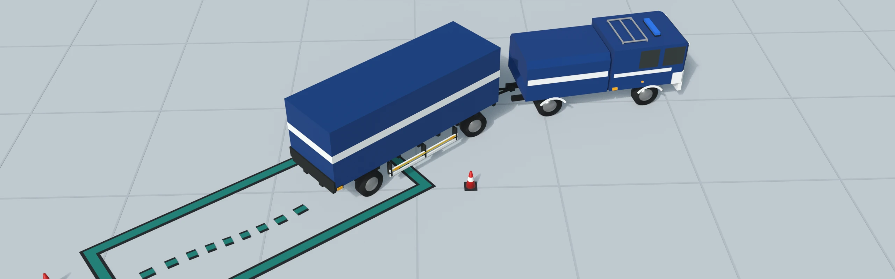

<picture>
  <source media="(prefers-color-scheme: dark)" srcset="docs/brand/banner-dark.webp">
  <source media="(prefers-color-scheme: light)" srcset="docs/brand/banner-light.webp">
  
</picture>

# Gegenlenker

[](https://scorecard.dev/viewer/?uri=github.com/DocGerd/gegenlenker)
[](https://www.bestpractices.dev/projects/17033)

A trainer for maneuvering a truck with a turntable drawbar trailer: reverse, steer against the trailer and dock it, in the browser and offline-capable.

Live, the latest release: https://docgerd.github.io/gegenlenker/ ([releases](https://github.com/DocGerd/gegenlenker/releases))

UAT, the current `develop` build: https://docgerd.github.io/gegenlenker/uat/

## Quickstart

Requires Node and pnpm as pinned in `.nvmrc` and `package.json`.

```sh
pnpm install
pnpm dev        # dev server
pnpm test       # unit tests
pnpm test:e2e   # Playwright offline check
pnpm test:perf  # headed, hardware GL, local only
pnpm perf:tablet  # emulated tablet on the real GPU, local only (docs/perf.md)
pnpm build
pnpm verify     # lint, format, typecheck, unit and e2e tests
```

## Layout

- `src/`: the app
- `docs/`: reference documentation

## Documentation

- [User guide](docs/usage.md): controls, views, exercises, settings, URL parameters, browser storage
- [Vehicle data](docs/vehicle-data.md): sources and the generated table of estimated parameters
- [Brand](docs/brand/BRAND.md)
- [Wording glossary](docs/glossary.md)
- [Engine choice ADR](docs/decisions/0001-engine-choice.md); [gitflow ADR](docs/decisions/0002-gitflow-release-flow.md)
- [Release flow](docs/releasing.md): branches, who merges what, releases and hotfixes
- [Asset credits](docs/asset-credits.md): source and licence of each third-party asset
- [Changelog](CHANGELOG.md); [changelog fragments](changelog.d/README.md)
- [Contributing](CONTRIBUTING.md); [code of conduct](CODE_OF_CONDUCT.md)
- [Security policy](SECURITY.md)

## Licence

Apache-2.0. The app's About screen lists every bundled licence, generated by `pnpm credits` from the files in `public/licenses/` and the CC0 asset sources in [`docs/asset-credits.md`](docs/asset-credits.md).

© 2026 Patrick Kuhn
